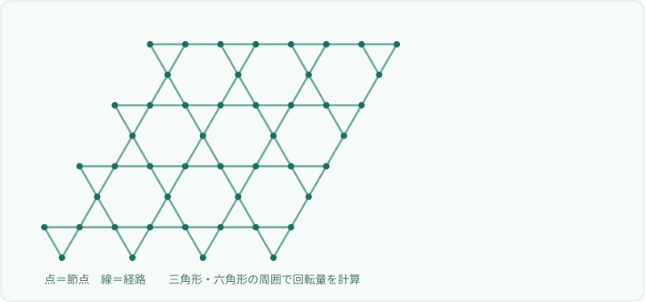

# カゴメ解析ツール 仕様書

対象は **v1.0.3**。文書の更新日は2026年11月26日です。

初めてこのツールに触れる人が、目的、入力、計算、結果の読み方を順に理解できるように説明します。第1～9章で基本をつかみ、第10章以降で保存方法や詳細な仕様を確認できます。

## 1 このツールは何をするものか

**カゴメ構造の経路に数値を入れ、流れと回転量を計算し、基準や変更前の状態と比較するソフトです。**

カゴメ構造は、三角形と六角形が組み合わさったネットワークです。経路の条件や分かれ方を入力すると、各経路の量、三角形・六角形の右回りと左回りの量、その差を求めます。

中心となるのは用途に依存しない共通モデルです。交通版は、その共通パラメータを車線数・道路長・交通量などの言葉で表示する適用例です。画面で「特許版（基本解析）」と呼んでいるものが汎用版に当たります。版を切り替えても、入力した数値や計算式は変わりません。

利用者は「この量を何と対応させるか」「どの単位を使うか」「どの結果を望ましいとするか」を決めます。一方、計算式と入力の制約はソフトで定めます。物理的な意味を変えるときも、単位と関係式の整合を確認します。

基本の使い方は次の流れです。

**解析範囲と入口条件を決める → 内部の条件を入力する → 標準を作る → 必要なら入口の受入量を調整する → 内部の流れ・回転量を計算する → 比較して保存する**

## 2 最初に覚える言葉



図は実装の格子接続から描いたものです。説明のため矢印と入力値は省いています。

| 言葉 | このソフトでの意味 |
|---|---|
| 節点 | 経路が交わり、流れが分かれる場所。C・D・Eは節点の種類を表す名前 |
| 素辺 | 節点から次の節点へ向かう1本の経路。進む向きを持つ |
| 有向 | 進む向きを区別すること。同じ2地点間でも、行きと帰りは別の素辺 |
| 面 | 三角形または六角形として囲まれた部分 |
| 回転量 | 面の周囲で、右回り・左回りに寄与する局所的な量を足したもの |
| 正味回転 | 右回りの回転量から左回りの回転量を引いた値 |
| 標準状態 | 各素辺を所定の臨界量に置いて作る、比較用の基準 |
| 余白 | 解析範囲の外側に付ける1リング分の格子。境界付近の計算に必要な値を持たせる |

大文字の **N** は格子の規模です。小文字の **n** は、後述する「素片内にある量」です。別の意味なので区別します。

図の線を長く描くことと、入力する長さLを変えることも別です。格子の図形配置を保ったまま、各素辺に異なるLを設定できます。

## 3 最初に動かす手順

1. [ツール一覧](https://t-kouhei.github.io/kagome-tools/)から汎用版を開きます。
2. 「5分の操作例」を開き、「一様な入力を用意」を押します。
3. 「解析して変更前を固定」で、最初の結果を計算します。
4. 「流量を2400へ変更」で、Vだけを変更します。
5. 「変更前後を比較」で、回転量や容量比の前後を確認します。
6. 必要な入力はJSON、結果はZIPで書き出します。

[操作例を直接開く](https://t-kouhei.github.io/kagome-tools/app.html?profile=patent&demo=flow&v=1.0.3)こともできます。新しい例に置き換える前に、必要な編集を保存してください。既存の保存ケースは残ります。

## 4 入力方法は2通りある

### 4.1 各経路の量を直接入れる

画面では「各素辺の観測流量を使う」を選びます。各素辺のVを利用者が指定し、その値から回転量などを計算します。合成データや、手元の経路別データを調べるときに使えます。

この方法では、m・L・vを変更しても、入力済みのVはそのままです。例えばVを固定して速度vだけを2倍にしても、基本設定のj=V/mは変わりません。

### 4.2 入口の量から内部の流れを求める

画面では「入口の流入量から計算する」を選びます。外から入る量と、各節点での分岐割合を指定し、内部のVを計算します。このとき、素辺表のVを直接の入力値としては使いません。

配分を変えたときの流れを調べる場合は、こちらを使います。外へ出られない閉じた循環などがあり、一意な定常解を扱えない入力では計算を停止して理由を示します。

### 4.3 解析範囲と外側との出入りを決める

現在の格子は有限の範囲を切り出したもので、外側に入口と出口があります。入口から計算する方法では、各入口の流入量を指定します。外周から出た流れを反対側の端へ戻す周期境界は使いません。

「周囲に余白」を選ぶと外側に1リングの格子が付き、そのさらに外周が入口・出口になります。余白の素辺にも値が必要です。余白は内側の局所計算を支える情報であり、外部の流入条件の代わりにはなりません。

**入口のinflowを0にすると、その入口からの外部供給を0にします。** 経路を削除したり、その向きを網全体で通行禁止にする操作ではありません。内部の分岐でほかの向きから曲がり、その方向へ進む流れはあり得ます。標準状態の経路や容量も、入口を0にしただけでは消えません。

## 5 何の数字を入力するか

基本設定の例では、全素辺に次の値を入れます。単位は利用側でそろえます。

| 記号 | 入れるもの | 例 | 基本の条件 |
|---|---|---:|---|
| m | その素辺にまとめた並列経路の数・重み | 2 | 正の実数。図に描く接続本数とは別 |
| L | 素辺の長さ | 0.5 | 正の値 |
| v | 輸送速度 | 40 | 入力する場合は正の値。Lと共通の長さ単位を使う |
| V | 単位時間あたりの総輸送量 | 1600 | 0以上。直接入力する方法では必須 |
| μ | 規格化した量の臨界基準 | 1000 | 入力する場合は正。Jと同じ単位 |
| T | 分布の幅 | 100 | 入力する場合は正。μと同じ単位 |
| θ | 分布のどこを臨界点とするか | 0.5 | 0より大きく1より小さい値 |

分岐割合は、**直進・右回り・左回りを0以上とし、合計を1**にします。例では直進0.60、右0.25、左0.15です。進入する方向ごとに設定します。

Tは、この計算で分布の幅を定める変数です。物理的な温度として対応させる場合の意味は、利用側で決めます。

基本設定では全素辺にmとLを入力し、直接入力する方法ではVもそろえます。μ・Tが全素辺にそろっていない場合は、容量や標準状態を使う比較を省略します。vを省略できる基本設定もありますが、その場合はnへの換算ができません。初めて使うときは表の項目をすべてそろえると、各機能を確認できます。

### 5.1 「そこにある量」と「流れる量」を区別する

素片内にある量nからVへ換算する場合は、次を使います。

```text
V = n × v / L
n = V × L / v
```

例としてn=20、v=40、L=0.5なら、V=1600です。画面の「nから流量Vに換算」で、このVを入力できます。

Vを1600に保ってvを40から80へ変えると、換算したnは20から10へ変わります。「Vを固定する実験」と「nを固定する実験」は異なります。nを固定したい場合は、vやLを変えた後でVを再換算します。

## 6 入力した数字をどう計算するか

### 6.1 経路ごとの量を規格化する

新規解析の基本設定は、画面の`norm=m / tau=engine`です。

```text
j = V / m
```

V=1600、m=2なら、j=800です。画面やCSVでは、規格化量をJと書く箇所もあります。基本設定では同じ値です。

### 6.2 節点での曲がる寄与を求める

局所回転τは、入ってくる側のj、分岐割合β、入る辺と出る辺の条件から求めます。

```text
τ = j_in × β × L_in / (m_out × L_out)
```

`in`は入る側、`out`は出る側です。同じm・Lの一様な例では、右回りの寄与は800×0.25÷2=100、左回りは800×0.15÷2=60になります。

jを求めるときのmと、τの出る側のmは、採用した式のそれぞれの位置にあります。交通の台数などへ意味付けするときも、この式を勝手に省略しません。

### 6.3 三角形と六角形の回転量を求める

- 三角形は、対応する3個のτを足します。上向き・下向きを分けます。
- 六角形は、対応する6個のτを足します。
- 右回りと左回りを別々に計算し、その差を正味回転とします。

一様な例の六角形なら、右回りは100×6=600、左回りは60×6=360、正味は600−360=240です。

正味が同じでも、右と左の量が同じとは限りません。そのため3つを別々に保持します。直進ポテンシャルも出力しますが、モデル上の分解量なので、実測した直進輸送量との対応は用途ごとに確認します。

## 7 標準状態と容量をどう作るか

### 7.1 分布値fと臨界量

基本設定ではε=jとし、次の増加型の式を使います。

```text
f(ε) = 1 / [1 + exp((μ − ε) / T)]
ε* = μ + T × ln[θ / (1 − θ)]
```

εが増えるとfも増え、ε=μでf=0.5になります。Tはその変化の幅を決めます。**fを実測確率や良し悪しの点数として扱うかは、別に定める必要があります。**

原資料の減少型の式と対応させる場合は1−fと読み、しきい値も1−θへ対応させます。

### 7.2 基本の容量と標準状態

```text
c = m × ε*
θ = 0.5 のとき c = m × μ
```

m=2、μ=1000、θ=0.5ならc=2000です。V/cは、この基準に対する現在の量の比です。V=1600なら80%、V=2400なら120%になります。

全素辺にcを置き、現在と同じm・L・分岐割合を使って回転量を計算したものが標準状態です。一様な例では、六角形の標準は右750、左450、正味300です。

この標準は比較用の参照状態です。各節点で流入と流出がつり合う実際の流し方とは区別します。一般の可解格子理論の厳密解を計算したという意味にはしません。

容量として使うε*とcは、**正の有限値**に限定します。μ・Tが正でも、θの取り方によってε*が0以下になる場合があり、その入力では容量を使う解析を停止します。

<a id="admission"></a>

### 7.3 標準状態を使って、入口で受け入れる量を決める

ここが「格子に入れる／入れない」に対応する処理です。入口から計算する方法で、詳細設定の**「方向別の標準総量に合わせる」**を選びます。初期値は「調整しない」です。観測した各素辺のVを直接使う方法では、この入口調整を適用しません。

1. 各素辺の臨界量cを計算し、6方向ごとに足して標準総量Cを作る。
2. 各入口に、外から入れたい要求量を指定する。
3. 現在の分岐割合のまま流したとき、各方向の区間合計がCを超えないよう、入口の受入量を求める。
4. 受け入れた量で内部の流れと回転量を計算する。

入口調整の標準総量と方向別の区間合計は、余白を含む全素辺（all）で集計します。結果画面で内側（inner）だけを表示した数値とは、集計範囲が異なります。

各入口の要求量に同じ割合を掛けて増やし、ある方向が上限に達したら、その方向の内部負荷を増やす入口の増加を止めます。残る入口は増やし続け、要求量または別の方向の上限まで進めます。入口の向きだけで判断せず、内部の分岐によってどの方向へ流れるかを含めます。

単なるON/OFFに限らず、「要求6000のうち2000を受け入れる」のように部分的な受け入れを計算します。要求量、受入量、未受入量を分けて保存します。未受入量の待ち行列や、次の時刻への繰越は計算しません。

標準状態は先に用意する比較基準、入口調整はその基準を使って実際の流し方を試算する処理です。入口調整を選んでも、各素辺のVがすべて標準量になるとは限りません。また、方向別総量が基準内でも、個々の素辺の容量を守れるとは限りません。局所の超過は別途確認します。

### 7.4 入口調整を確かめる数値例

N=3、余白あり、m=2、μ=1000、T=100、θ=0.5とし、入口調整だけを見やすくするため直進100%・右左0%にします。内部の配分調整は「調整しない」です。全38入口が直進で内部に接続し、各素辺の容量はc=2000です。既存の計算機能を確認する合成入力で、先生の指定例としては扱いません。

| 入力 | 外からの要求合計 | 受入合計 | 未受入合計 |
|---|---:|---:|---:|
| 全38入口に1000ずつ | 38000 | 38000 | 0 |
| 全38入口に6000ずつ | 228000 | 76000 | 152000 |
| 向き6の9入口は0、ほかの29入口に6000ずつ | 174000 | 58000 | 116000 |

2行目では各入口の受入量が2000になります。向き1について、外からの要求は5入口×6000=30000、受け入れは5入口×2000=10000です。一方、内部の向き1は45区間あるため、区間合計は270000から90000へ変わります。標準総量は45×2000=90000です。**入口の量30000→10000と、方向別の区間合計270000→90000は別の数値です。**

3行目では向き6への外部流入が0になります。この例は直進だけなので内部の向き6の流れも0ですが、標準総量は41区間×2000=82000のままです。

次のJSONを保存し、画面の「保存した入力・ファイルを使う」→「入力JSONを読み込む」から開いて解析できます。必要な編集中の入力は先に保存してください。

- <a href="https://t-kouhei.github.io/kagome-tools/examples/admission/low.json" download>全量を受け入れる入力JSON</a>
- <a href="https://t-kouhei.github.io/kagome-tools/examples/admission/high.json" download>要求量の3分の1を受け入れる入力JSON</a>
- <a href="https://t-kouhei.github.io/kagome-tools/examples/admission/direction-6-off.json" download>向き6の外部流入を0にした入力JSON</a>

Python版のダウンロードZIPにも、`examples/admission/`に同じ入力を同梱します。ZIPを展開してから読み込んでください。

結果の`global.csv`には方向別の標準総量・調整前後の区間合計・入口の要求／受入／未受入量を、`entrances_admitted.csv`には入口ごとの受入量・要求量・割合を保存します。`report.json`の`operations.global`にも同じ情報があります。入口調整と内部調整を併用した場合、`global.csv`は入口調整時点の記録であり、内部調整後の最終集計は別に確認します。

## 8 結果は何と比べるか

### 8.1 同じ場所の標準と比べる

現在値から、その面自身の標準値を引きます。「その場所の基準より、どれだけ多い・少ないか」を見ます。

### 8.2 全体の標準平均と比べる

解析範囲内に完全に含まれる六角形の標準値を、同じ重みで平均します。右・左・正味ごとに平均を求め、現在値から引きます。

例えば、2つの六角形の標準が10と20なら、標準平均は15です。

| 六角形 | 現在値 | 同じ面の標準 | 個別標準との差 | 標準平均15との差 |
|---|---:|---:|---:|---:|
| A | 12 | 10 | ＋2 | −3 |
| B | 18 | 20 | −2 | ＋3 |

Aがプラスになる比較とマイナスになる比較があります。比べる相手が違うためです。現在値が標準そのものでも、面ごとの標準が異なれば、標準平均との差は0とは限りません。

**差の正負は基準に対する過不足です。実際の回転方向や良否を、その符号だけから決めません。**

### 8.3 変更前と変更後を比べる

「変更前を固定」した後で条件を変え、「変更前と比較」を実行します。現在値の変化と、標準値の変化を別々に表示します。六角形の標準平均との差を前後で比べる場合は、変更前の標準平均を共通の基準として保ち、変更後自身の標準平均も別に残します。

配分調整の設定を切り替えた場合も、変更前は固定したときの設定で計算します。

## 9 一様な例で前後を確かめる

m=2、L=0.5、v=40、μ=1000、T=100、θ=0.5、直進60%・右25%・左15%を固定し、Vだけを変えます。

| 状態 | V | j | 右回り | 左回り | 正味 | 正味−標準300 | V/c |
|---|---:|---:|---:|---:|---:|---:|---:|
| 変更前 | 1600 | 800 | 600 | 360 | 240 | −60 | 80% |
| 比較用標準 | 2000 | 1000 | 750 | 450 | 300 | 0 | 100% |
| 変更後 | 2400 | 1200 | 900 | 540 | 360 | ＋60 | 120% |

この条件ではVを1.5倍にすると、回転量も1.5倍になります。容量比が100%を超えたことは、設定したcを超えたという意味です。実対象での混雑や異常との対応は、入力の意味付けと検証に依存します。

## 10 画面で確認できること

| 場所・機能 | 確認する内容 |
|---|---|
| 格子と入力表 | 素辺ごとの条件、節点での分岐、入口の量。検索・一括変更・取り消しができる |
| 結果の冒頭 | 変更項目、前・後・差。回転量、標準平均、容量比、超過本数など |
| 六角形の比較表 | 右・左・正味を選び、個別標準との差と標準平均との差を同時に見る |
| 格子の色分け | 各素辺や各面の分布。平均だけでは見えない局所の違いを確認する |
| 計算過程 | 入力、規格化、τ、面の回転量への寄与を追う |
| 条件の一括比較 | 1項目を2～12個の値に置き換え、表とグラフで比べる |
| 計算の版と再現記録 | 入力・計算コードの識別情報と、再実行用ファイル |

平均が同じでも、各場所の値は変わっている可能性があります。平均の比較と、格子の分布表示を組み合わせて読みます。

### 10.1 集計する範囲

`inner`は解析範囲内の両端を持つ素辺、`all`は余白を含む全素辺です。六角形の基本集計は、全頂点が解析範囲内にある完全な六角形を対象とします。

6方向の合計は、その方向を向く**区間ごとの流量の和**です。同じ流れ100が2区間を通れば合計は200になります。入口から入った量100や、経路を通せる最大量とは別の指標です。

## 11 5つの比較例を使う

[比較例を開く](https://t-kouhei.github.io/kagome-tools/app.html?profile=patent&effect=bottleneck&v=1.0.3)と、変える条件と固定する条件を示して、前後を実際に計算できます。

| 比較例 | 変えるもの | 確認できる違い |
|---|---|---|
| 流量を増やす | Vを1600→2400 | 正味平均240→360、容量比80%→120% |
| 正味が同じで内訳が違う | 右25%・左15%から右35%・左25%。直進は残り | 正味240は同じ。右600→840、左360→600 |
| 比較基準を変える | μを1000→1200 | 現在の回転量は同じ。標準正味平均300→360 |
| Vを固定して速度を変える | vを40→80 | 基本設定のjと回転量は同じ。換算したnは平均20→10 |
| 配分調整を試す | 同じ入力で局所LPをなし→あり | 合成例では入口量228000を保ち、容量超過1本→0本 |

最後の例は、1本だけ細い経路を入れた合成データです。設定した容量条件を満たす結果が得られたことを確認します。ほかの入力でも必ず同じ効果が出る、という意味にはしません。

## 12 配分調整と仮のスピン積

### 12.1 配分調整で試せること

入口から計算する方法では、第7.3節の方向別の制限や、参考として最大流による受入量、局所の分岐調整を試算できます。入口調整が外から受け入れる量を変えるのに対し、内部調整は受け入れた量の配分を変えます。局所LPは、設定した容量などの制約のもとで、指定された変更量の目的関数を扱う線形計画です。

結果には、解消・未解消、残った超過、停止理由などを表示します。入口の量を減らして超過が減った場合と、同じ入口量で配分を変えた場合を区別できるよう、入口・出口の量も併記します。信号機や実設備へ操作を自動送信する機能は含みません。

### 12.2 仮のスピン積は参考指標

仮の積では、面の正味回転を使い、2面の積や4面の積を求めます。係数・組み合わせ・規格化はソフト側で採用した暫定の規約であり、先生の相互作用エネルギーとして確定したものとは扱いません。

標準が(10,10)、現況が(20,5)なら、積はどちらも100です。それでも各面の回転量は変わっています。**積は、回転量の一致や過不足の代わりにはなりません。** 基本の成分別比較とは別の参考欄に置きます。

規格化には対象面の標準の正味回転の絶対値平均を使います。その平均が0、または対象面がない場合は「算定保留」です。係数1などへ置き換えず、JSONではnull、CSVでは空欄、画面では「–」と理由を示します。回転量の基本比較は引き続き使えます。

## 13 入出力ファイルと保存

### 13.1 入力ファイル

入力は画面から編集でき、JSONで一式を書き出せます。CSVは3種類あります。

| ファイル | 1行が表すもの | 列名と順序 |
|---|---|---|
| edges.csv | 1つの有向素辺 | node_type, i, j, road, m, L, v, V, T, mu |
| branching.csv | 節点と進入方向ごとの分岐 | node_type, i, j, in_road, S, R, L |
| entrances.csv | 1つの入口 | node_type, i, j, in_road, inflow |

場所を表す列は格子に対応しています。画面から書き出したテンプレートを使い、列名・順序・必要な行を保ってください。空欄は未入力で、0とは区別します。

`edges.csv`のLは長さ、`branching.csv`のLは左分岐です。分岐表のSは直進割合で、正味スピンを表す記号Sとは別です。

入力JSONのトップレベルの`n`は、格子規模Nを保存するキーです。素片内の量nではありません。格子の形と計算設定は`lattice.json`にも保存します。JSONは必要な全行を含むため、画面から書き出す方法を基本とします。

### 13.2 主な結果ファイル

| ファイル | 内容 |
|---|---|
| viewer.html | 図と表で結果を見る画面 |
| report.json | 集計、標準、配分調整、前後比較、計算の説明 |
| edges_result.csv | 素辺ごとの入力値・規格化量・容量比など |
| tau.csv / rotation.csv | 局所回転、三角形・六角形の成分 |
| hex_rotation.csv | 現在値、標準平均、その差、個別標準、個別差 |
| direction_comparison.csv | 範囲と方向ごとの区間集計 |
| interactions.csv | 仮の積。算定保留時は数値を空欄にする |
| provenance.json | ソフト・定義・入力・実装・実行環境の識別情報 |

前後比較では変更前と変更後の結果、差の表も保存します。一括比較では各条件の結果と一覧をまとめます。ZIPで入力・結果・計算の版を持ち帰れます。

### 13.3 保存場所

ブラウザ版の入力と結果は、その端末・ブラウザの保存領域に残ります。別の端末へは自動同期されません。結果の`/files/…`というURLも、そのブラウザ内の保存結果を開くものです。他人に結果を渡すときは、ZIPなどのファイルを共有します。

大切な入力はJSON、結果はZIPでも保存してください。ブラウザの保存データを消すと、ブラウザ内のケースも失われる場合があります。

Python版は、起動したツールの`gui-work`へ画面の作業を保存します。従来のコマンド用`work`・`out`とは保存先を区別します。

## 14 入力が使えないときの動作

| 条件 | 動作 |
|---|---|
| 必須値の未入力、必要な正値が0以下、負のV、非有限数 | 入力の確認を促す。計算に必要な条件を満たさなければ停止 |
| 分岐が負、または合計が1でない | 修正を促す |
| θが範囲外、容量用のε*やcが0以下・非有限 | 容量を使う解析を停止し、μ・T・θの変更を促す |
| 入力場所の欠落・重複・格子との不一致、CSVの列違い | 読み込みや計算を停止し、形式を確認する |
| 出口へ到達できず、一意な定常解を扱えない | 理由を示して停止 |
| 仮の積の標準スケールが0 | 積だけを算定保留にし、基本の回転量は表示 |
| 一括比較の一条件だけが失敗 | その条件の理由を残し、次の条件を扱う |
| 一括比較中にページを再読み込み | 中断と表示。完了済みの個別結果は残る |

出入りの釣り合いや値の桁の違いなどは、警告になる場合もあります。計算が完了したことと、その入力が対象を適切に表していることは分けて確認します。

## 15 今回の完成範囲

今回の完成対象は、**汎用のカゴメ構造に条件を入力し、採用式で計算し、比較し、保存できること**です。

交通は適用例です。SUMOによる実証や実交通データでの効果、用途ごとの物理的な対応付けは、今回の基本ツールの完成条件には加えません。

先生の理論との対応について、相互作用の具体式・係数・縮約、原資料の一部の添字などは確認事項として保持します。ソフトで採用した規約を先生の確定式や一般の厳密解の証明へ読み替えません。湧き出し・吸い込みの別レイヤー、20・32・64頂点模型などは、今回の基本解析範囲外です。

検証では、既存216件と入口調整の追加5件（計221件）のテスト、画面での5種類の比較と3つの入口調整入力、保存・復元・ZIP、交通版と汎用版の数値一致、Python版との数値照合を確認しました。これらは実装の確認であり、実対象での有効性の実証とは区別します。

## 16 開発や引き継ぎで確認すること

### 16.1 基本以外の計算設定

`norm=k`はV/(v×m)、`norm=mvl`はV×v/(L×m)です。`tau=count`も比較用に残しています。規格化を変更するとμ・Tの単位も変わるため、明示的な換算を行います。既存ケースの設定を、自動的に新規の基本設定へ置き換えません。

CLIで`--eps straight`を選ぶと、分布は直進成分で評価します。ただし容量と標準状態はJから作るため、その標準の直進成分の分布値がθになるとは限らない旨を記録します。

単独の分布APIは、ε*が非負量の範囲外になる数学的な場合も扱えます。その場合は状態を明示し、比をnullにします。正の容量を必要とする解析とは入口の条件を分けます。

### 16.2 計算の版と原資料への対応

現在の定義の識別子は`kagome-source-routing-20261125.2`です。入力と計算コードのSHA-256、環境、再実行用の実装を結果へ記録します。識別情報は計算を追うためのもので、先生の承認や署名の証明ではありません。

原資料の個別式24項には、参照先を図形の進行方向へそろえた7項と、別にβのR/L表記差1項があります。ソフトの採用規約と原資料の表記差を記録し、原資料を誤植と断定して書き換えません。計算上の右・左の成分、三角形3項・六角形6項の和という定義は保持します。

### 16.3 文書とソースの場所

| 場所 | 役割 |
|---|---|
| プロジェクト直下の仕様書.md | 現在採用している仕様の入口 |
| kagome-lattice-tool | 開発本体・テスト・保存ケース |
| 完成物/ツール | Python配布用の本体 |
| 完成物/解説書 | 仕様書のHTML、原理、操作説明、5分の操作例 |
| reference | 先生の原資料と読解記録。公開ツールへ原ファイルを含めない |
| docs | 検証・理論照合などの記録 |

公開用リポジトリは[GitHub](https://github.com/t-kouhei/kagome-tools)です。公開版は同じ計算コードをブラウザ内で実行し、公開サーバーへ入力データを送って計算する構成ではありません。

詳しい画面操作は[使い方](https://t-kouhei.github.io/kagome-tools/usage.html)、式と背景は[原理解説](https://t-kouhei.github.io/kagome-tools/principles.html)、説明するときは[5分の操作例](https://t-kouhei.github.io/kagome-tools/demonstration.html)へ進んでください。
